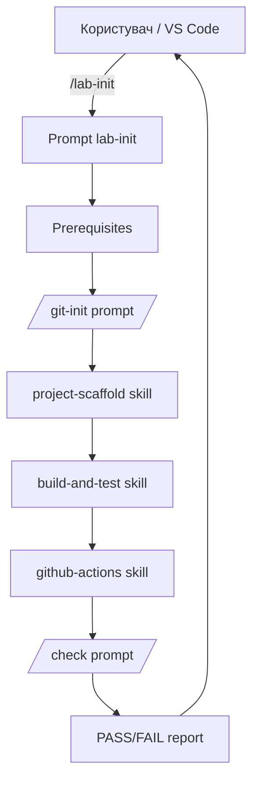

# Архітектура AI-агента

## Призначе

Агент вирішує проблеми неповної генерації лабораторного проєкту, розривів між TypeScript-збіркою й CI, ручного створення кросплатформних обгорток і небажаних повторних змін. Він координує ідемпотентне створення scaffold, тестів, CI та перевірку репозиторію.

Для варіанта 6 технологічна конфігурація замінює рекомендовану структуру з `CMakeLists.txt`: замість CMake використовуються `package.json` та `tsconfig.json`, npm scripts і Vitest. Основною гілкою репозиторію для документації й очікуваної перевірки є `main`; у вимогах також враховано гілки `master` і `develop`.

## Роль файлів

| Файл | Роль |
|---|---|
| `.github/agents/build-engineer.agent.md` | Custom agent manifest; роль, tools, skills/commands, правила та критерії успіху |
| `.github/skills/project-scaffold/SKILL.md` | Agent Skill для TypeScript/npm scaffold |
| `.github/skills/build-and-test/SKILL.md` | Agent Skill для scripts, Vitest, ci-скриптів та обгорток |
| `.github/skills/github-actions/SKILL.md` | Agent Skill для GitHub Actions workflow |
| `.github/prompts/*.prompt.md` | Prompt files, які реалізують команди `/git-init`, `/create-project`, `/create-build`, `/create-actions`, `/check`, `/lab-init` у VS Code Copilot |
| `docs/architecture.md` | Архітектура, потоки даних і обробка помилок |
| `docs/usage.md` | Локальний і VS Code сценарії запуску |
| `docs/ai-log.md` | Шаблон журналу AI-рішень |
| `README.md` | Дані студентa, варіант, запуск `/lab-init` і `/check` |

У VS Code Copilot команди реалізовано як **prompt files** у `.github/prompts/*.prompt.md`, а повторно використовувані процедури — як **Agent Skills** у `.github/skills/*/SKILL.md`.

Оркестратор `init` з методички реалізовано як команду `/lab-init`: назва `/init` конфліктує із вбудованою командою VS Code, яка створює `.github/copilot-instructions.md`.

## Схема взаємодії

## Дані між етапами

- `/lab-init` передає поточну робочу директорію та статус prerequisite наступним крокам.
- `/git-init` передає стан гілки й доповнений `.gitignore`.
- `project-scaffold` передає наявний scaffold, package scripts і імпортувальні точки TypeScript.
- `build-and-test` передає зібрані артефакти, результати Vitest і локальний CI. Обгортки в `build/` породжує `postbuild` і скрипт `scripts/make-wrappers.mjs`; каталог `build/` не передається як source-контент Git.
- `github-actions` передає workflow matrix ОС у `/check`.
- `/check` передає таблицю PASS/FAIL і підсумковий exit code користувачу.

## Обробка помилок

Кожен етап перевіряє свій очікуваний результат. При помилці оркестратор зупиняється на першому невдалому кроку, показує назву кроку й конкретну причину, не запускає наступну command і завершує `/lab-init` помилкою. `/check` завжди читає стан, не змінює файли та завершується ненульовим кодом при хоча б одному FAIL.
